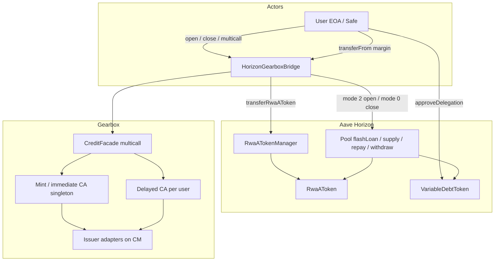

# Horizon ↔ Gearbox Bridge

Intermediary (`HorizonGearboxBridge`) that opens and closes [Aave Horizon](https://aave.com/docs/aave-v3/horizon) RWA borrow positions by minting / redeeming collateral through Gearbox Credit Accounts.

## Net effect

| Action | Horizon | Gearbox |
|--------|---------|---------|
| `openPosition` | User holds RWA aTokens + variable stable debt | No lasting position (reusable mint CA ends with 0 debt) |
| `closeImmediate` | Position cleared | No lasting position (same singleton CA, 0 debt) |
| `closeDelayed` | Position cleared | New/existing user-mapped CA borrows against redemption phantom; user fully controls it via `multicall` |

## Architecture

### Roles

| Actor | Required permissions |
|-------|----------------------|
| **User** | Issuer / RWA transfer whitelist where applicable; `VariableDebtToken.approveDelegation(bridge, amount)` before open; ERC20 `approve` for margin |
| **Bridge** | `AUTHORIZED_TRANSFER_ROLE` per RWA aToken on `RwaATokenManager`; issuer whitelist for RWA transfers; optional Horizon `FLASH_BORROWER` (premium may be non-zero without it) |
| **Mint CA** | Borrower = bridge; CM adapter set defines allowed mint / immediate exit routes |
| **Delayed CA** | Borrower = bridge; mapped user has full facade proxy via `bridge.multicall` (including `setBotPermissions`) |

## Flows

### Open (`openPosition`)

1. Pull `marginAmount` of `stableAsset` from user (`transferFrom` only in this draft).
2. `flashLoan(stable, amount, interestRateMode=2, onBehalfOf=user)`.
3. In callback: `addCollateral` flash + margin on mint CA → user allowlisted multicall (adapters + slippage/price selectors) → `withdrawCollateral(rwa → bridge)`.
4. `Pool.supply(rwa)` on bridge (Horizon blocks supply-on-behalf for RwaAToken).
5. `RwaATokenManager.transferRwaAToken(bridge → user)`.
6. Mode-2 debt opens on the user; HF must hold. Mint CA must end with **zero debt**.

### Close immediate (`closeImmediate`)

Same flash/repay/aToken-pull/withdraw path as delayed, but conversion runs on the **mint singleton**. User multicall may include `updateQuota` / `increaseDebt` / `decreaseDebt` / `withdrawCollateral(to: bridge)` so `amount + premium` can be repaid. **Post-condition: singleton debt == 0** (no lasting Gearbox position). Immediate vs delayed exit is entirely determined by the connected adapters (issuer may offer sync redeem or liquid routes).

### Close delayed (`closeDelayed`)

1. `flashLoan(debt, mode=0)`.
2. `repay` Horizon debt for user; `transferRwaAToken(user → bridge)`; `withdraw` RWA.
3. Open mapped CA if needed (one per `user × creditManager`).
4. `addCollateral(rwa)` + allowlisted multicall (redeem → phantom, `updateQuota`, `increaseDebt`, withdraw stable to bridge).
5. Approve Pool for `amount + premium` (borrowed from Gearbox). CA remains as a normal leveraged redemption position; user manages it via `multicall`.

## Call allowlists

Bridge validates user-supplied `MultiCall[]` **before** the flash loan. Adapter targets must be registered on the Credit Manager (`adapterToContract != 0`); the CM’s adapter set is the real product scope.

| Entry | Facade selectors | Adapters |
|-------|------------------|----------|
| Open | `storeExpectedBalances`, `compareBalances`, `onDemandPriceUpdates`, `setFullCheckParams` | Any registered |
| Close (both) | Open set + `updateQuota`, `increaseDebt`, `decreaseDebt`, `withdrawCollateral` (**recipient must be the bridge**) | Any registered |
| `multicall` (delayed CA) | **Full proxy** — no bridge selector filter | Facade / CM enforce as usual |

Bridge itself prepends `addCollateral` and (on open) appends RWA `withdrawCollateral` to the bridge.

## Securitize / `SecuritizeRWAFactory`

Not integrated in this draft. Factory ties `investor = msg.sender` and only allows factory→wallet multicalls, so the bridge cannot both drive the flash-loan callback and leave the end user as investor without factory changes (e.g. operator role). Prefer a normal Credit Manager with issuer adapters; factory support is a separate follow-up.

## Future additions (not in this draft)

- EIP-712 / permit-style **gasless or relayer** open & close (position creation via signature).
- ERC-2612 `permit` for margin `transferFrom`.
- Optional `FLASH_BORROWER` wiring once granted on Horizon ACL.
- Compressor helpers to build open/close `MultiCall` templates for UIs.

## Challenges

- **HF ordering on open:** aTokens must sit on the user before mode-2 debt is finalized; failed HF reverts the whole open.
- **Credit delegation:** user must `approveDelegation` to the bridge for the flash amount.
- **Authorized transfer trust:** `AUTHORIZED_TRANSFER_ROLE` is powerful; bridge only moves aTokens inside open/close paths with `msg.sender` as the user.
- **Close premium:** size Gearbox borrow for `debt + premium` (+ buffer); do not assume fee waiver.
- **Immediate close:** adapters must be able to realize enough stable in-tx to repay the flash loan and leave **zero** singleton debt.
- **RWA allowlists:** bridge, CAs, and user may all need issuer whitelist entries for transfers / mint / redeem.

## Contract layout

| Path | Role |
|------|------|
| `contracts/horizon/HorizonGearboxBridge.sol` | Main intermediary |
| `contracts/interfaces/IHorizonGearboxBridge.sol` | API + errors/events |
| `contracts/libraries/HorizonBridgeCalls.sol` | Multicall allowlist |
| `contracts/interfaces/external/aave/*` | Minimal Horizon / Aave interfaces |
